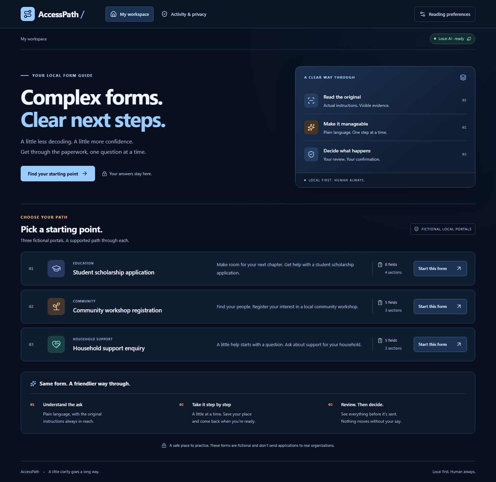

# AccessPath

**Forms, made clearer. One step at a time.**

[Public repository: ainazulfiqar99acc/AccessPath](https://github.com/ainazulfiqar99acc/AccessPath)

**Render upgrade:** a hosted Synthetic Demo mode is prepared locally, with Docker/Blueprint configuration, browser-bound drafts, expiry, sample-only inputs, a Next.js static export and a Groq Free-tier Qwen adapter. The user approved the GitHub push and public Free-service deployment. Rollout and public verification are in progress; no paid resource is authorized. See the [deployment review](docs/RENDER_DEPLOYMENT.md) for the architecture, Free-plan limits, configuration and remaining live checks. No public application URL is claimed.

AccessPath turns three deliberately confusing, **fictional local forms** into an accessible guided workflow. It reads actual HTML evidence, uses a local Qwen model to simplify the wording, keeps the originals beside the suggestions, and checks answers against the source constraints. A real Playwright browser fills and submits the fictional portal only after explicit confirmation.

The interface has been redesigned throughout with a midnight-blue palette, horizontal navigation, form rows, blue-and-amber controls, and responsive reading preferences. The current screenshots below show that design.



## Run on Windows

Requirements: Node.js 20.9+, Python 3.12, Ollama, and the `qwen3:8b` model. This implementation was tested with Node 22.14.0, Python 3.12.7, Ollama 0.40.8, and an RTX 4090. The installed Q4_K_M model occupies about 5.2 GB on disk; runtime memory needs additional headroom. CPU inference is supported by Ollama but was not benchmarked here.

```powershell
python -m venv .venv
.\.venv\Scripts\python.exe -m pip install -r backend\requirements.lock.txt
npm ci
.\.venv\Scripts\python.exe -m playwright install chromium
npx playwright install chromium
ollama pull qwen3:8b
.\scripts\start.ps1
```

Open **http://127.0.0.1:3103**. The API uses **9313**, and the fictional portal uses **9314**. All three services bind to loopback. The start script refuses occupied ports and never stops another project. Logs and this project's process IDs are in `logs/`. Run `ollama serve` separately if Ollama is not already running; do not start a second Ollama service over an existing one.

To stop only AccessPath, run `.\scripts\stop.ps1`. It verifies project-specific command lines before stopping processes; it does not stop Ollama or other projects. Then use `.\scripts\start.ps1` to restart.

The configuration reads process environment variables. `.env.example` documents them; `.env` files are not automatically loaded. Use the exact `127.0.0.1` frontend URL so the origin check matches. Keep the defaults when running alongside other sessions.

Manual alternative, from the project root in three terminals:

```powershell
.\.venv\Scripts\python.exe -m uvicorn backend.portal:app --host 127.0.0.1 --port 9314 --no-access-log
.\.venv\Scripts\python.exe -m uvicorn backend.main:app --host 127.0.0.1 --port 9313 --no-access-log
npm run dev
```

For production verification without interfering with the running dev server:

```powershell
$env:ACCESSPATH_BUILD_DIR='.next-production'
npm run build
# Stop only this project's dev web process before running on the same port:
npm start
```

Use the same `ACCESSPATH_BUILD_DIR` for build and start. `scripts/start.ps1` starts development mode. The optional Render Docker image builds a Next.js static export and serves it with the API and fictional portal in one Python container, preserving loopback-only automation. Hosted mode uses explicitly configured external inference; it does not connect to your workstation's Ollama.

## Try the real workflow

1. Choose the student scholarship, community workshop, or household support enquiry.
2. Select **Explain this form**. Qwen runs locally; the model receives only the fictional form fields and constraints, never applicant answers. Generated explanations are cached by source hash and model digest.
3. Compare the suggested wording with the original evidence. Ambiguous source instructions remain visible.
4. Confirm the source-derived preparation checklist. No documents are uploaded.
5. Answer one question at a time. Optional fields, conditional funding details, character limits, patterns, and number bounds come from HTML. Continue or save before leaving to preserve edits.
6. Review the full answer summary. The submit button remains disabled until you explicitly check the confirmation box.
7. A controlled browser fills the local portal and returns a fictional receipt. Inspect the activity trail and delete the local draft when finished.

There is one current draft per browser. Delete the existing saved form before starting another, so old answers are not silently abandoned. A successful submission stays readable until deletion. On reload, **Resume form** reopens source review; your saved question position is retained. AI wording can be loaded again from the source-version cache.

## What is implemented

- Next.js App Router, TypeScript, Tailwind v4, a shadcn-style Button built with Radix Slot, and native accessible form controls.
- FastAPI and typed Pydantic models, real BeautifulSoup DOM extraction, SQLite local drafts and value-free audit events.
- Real `qwen3:8b` structured inference through local Ollama, field/number/selected-claim guards, source-version caching, clear offline/error states, one inference at a time within this API process.
- Three separately served fictional HTML portals with browser and server validation.
- Keyboard navigation, focus management, error announcements, skip link, larger text, high contrast, and reduced-motion support.
- Ten-minute, single-use confirmation capability; any edit invalidates it. The application rechecks the DOM version and answers before automation. External browser requests are blocked.
- Local deletion of answers and audit records, with SQLite secure deletion enabled.

## Tests and evidence

```powershell
.\.venv\Scripts\python.exe -m pytest tests\test_backend.py tests\test_hosted.py -q
npm run typecheck
npm run test:e2e
.\.venv\Scripts\python.exe -m scripts.evaluate
npm run demo:record
```

Start all services before browser tests or recording. Tests use explicitly synthetic values and delete their own drafts. Backend consent unit tests use an explicitly scoped automation stub; end-to-end tests exercise the real browser and portal. The evaluation script runs fresh real model inference on all three source forms, sequentially, and stores results in `docs/evaluation-results.json`.

See [evaluation details](docs/EVALUATION.md), [architecture](docs/ARCHITECTURE.md), and the [demo script](docs/DEMO_SCRIPT.md). Screenshots are captured from the actual app. `demo/assets/video/demo_silent.mp4` is generated locally and ignored by Git because it is large.

The completed narrated demo is `demo/assets/video/final_demo.mp4`: **117.68 seconds, 1920×1080, Liam's voice, synchronized captions**. Captions occupy a dedicated band below the recorded screen. The video also includes a selectable subtitle track, and the separate SRT is at `demo/assets/audio/subtitles.srt`. See [voiceover reproduction and checks](docs/VOICEOVER.md).

Watch the [current narrated demonstration on YouTube](https://youtu.be/VmlFZgN95ro): the redesigned midnight-blue interface, Liam narration, and synchronized captions. The user-supplied upload is playable and embeddable; its rounded 118-second duration matches the 117.68-second local recording.

## Privacy and limits

The default is a local prototype for the three included fictional forms. The optional hosted mode is an anonymous, synthetic-only demo with isolated browser ownership; it is not a service for real applicants. Neither mode automates real agencies, makes eligibility decisions, uploads documents, or supports arbitrary websites. No CAPTCHA or authentication bypass exists. Local mode has no cloud fallback; hosted inference is an explicit configuration with its own privacy disclosure. Neither mode invents model responses.

Draft answers are **not application-encrypted at rest**. New drafts are bound to an HttpOnly browser cookie as well as their high-entropy draft ID; older local drafts retain their original capability semantics. Hosted mode requires a Secure cookie, fixed sample text, temporary server storage and a maximum two-hour draft lifetime. Hosted answers are stored on Render, not on the visitor's device; fictional instructions go to the configured external inference provider. Continue/save commits edits; unsaved typing can be lost on refresh. Deletion removes the selected draft and its activity from the app database, not screenshots, videos, platform backups or copies you made. The fictional portal returns a receipt without retaining applicant values.

Source-derived constraints are authoritative. Model output checks are structural and partial semantic guards, not a proof of faithful paraphrasing. A model can still make a mistake without triggering them. Browser automation has no tools available to the model; reviewed user input and fixed selectors control it. Automated axe scans cannot certify WCAG 2.2 AA, and no usability study with disabled participants has been conducted.

If the API process crashes mid-submission, a draft can remain `submitting`; no automatic retry occurs. There is currently no in-app crash reconciliation. Inspect this local state before deciding to delete/restart the draft; the fictional portal has no financial or real-world effect. Voice interaction, live-site adapters, authentication, encryption, and robust multi-user operation remain future work.

Qwen3 weights use [Apache 2.0](https://huggingface.co/Qwen/Qwen3-8B/blob/main/LICENSE). [Ollama structured outputs](https://docs.ollama.com/capabilities/structured-outputs) constrain the response schema. App source uses [MIT](LICENSE). Gemma models and the Gemma category are excluded.

## Publication status

The application, genuine screenshots, and narrated video are complete. The user selected Liam for narration and approved publication under [ainazulfiqar99acc/AccessPath](https://github.com/ainazulfiqar99acc/AccessPath), which is public on branch `main`. Source and genuine screenshots are published; local data, credentials, model files, and generated audio/video remain excluded. The user completed the YouTube handoff. The user published the [DEV challenge article](https://dev.to/zedaina/the-internet-is-open-to-everyone-filling-out-its-forms-isnt-18l5). The live post, current video embed, six accessible screenshots, source link, and required challenge tags were verified. See the [publication checklist](docs/PUBLISHING_CHECKLIST.md) and [verification evidence](docs/dev-publication-evidence.json).
