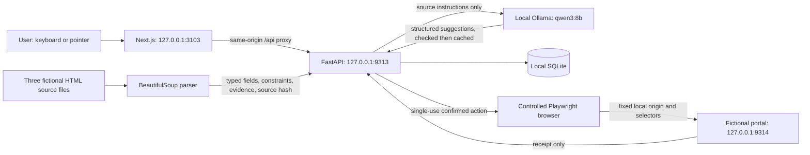
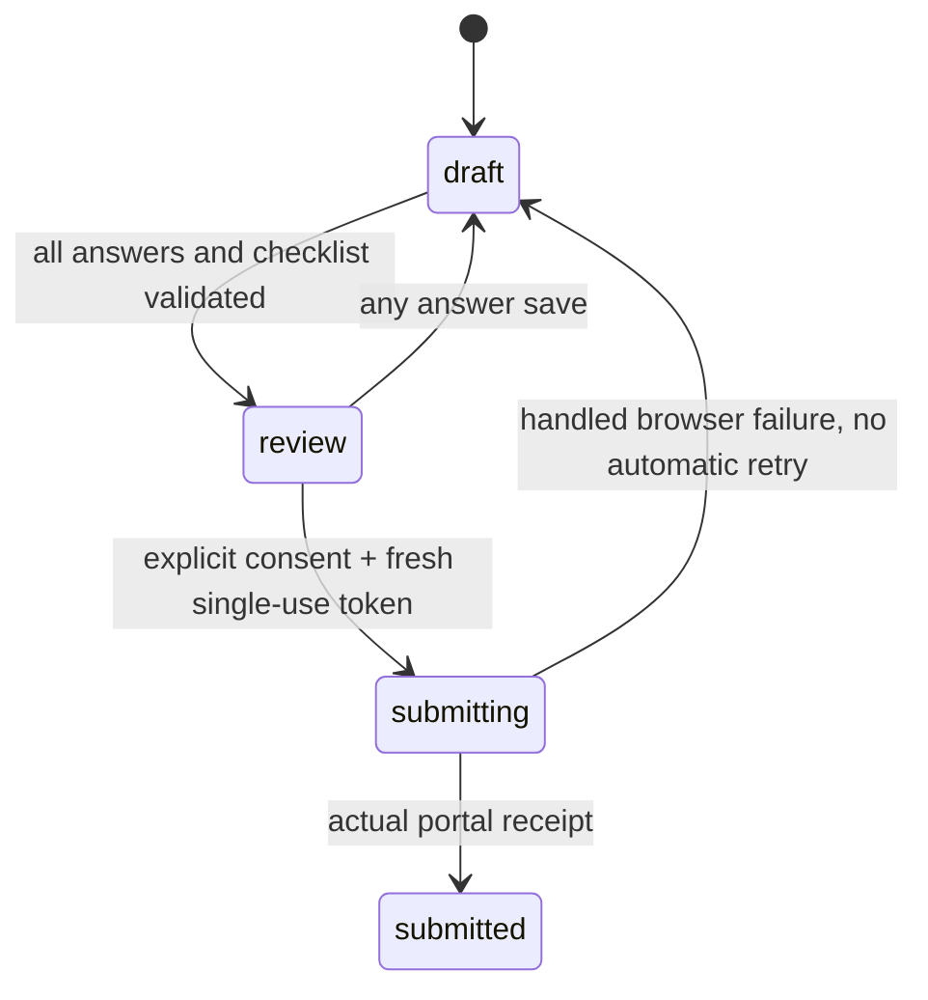
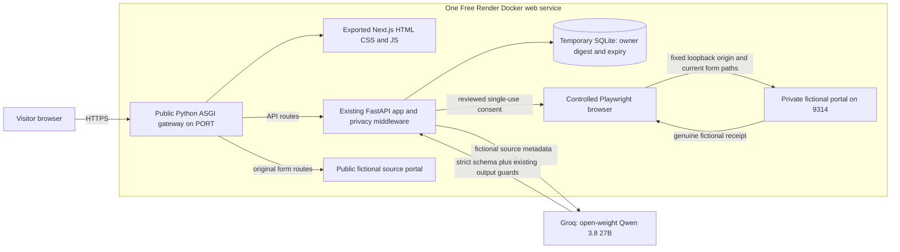

# Architecture

The local workflow below remains supported. The Render mode is live at https://accesspath-demo.onrender.com and passed the actual public browser journeys. See [deployment review](RENDER_DEPLOYMENT.md).

`backend/forms/*.html` is the source of truth. The separate portal serves it unchanged locally; hosted mode adds a static Synthetic Demo notice without changing form fields or instructions. `parser.py` reads labels, `aria-describedby` instructions, required flags, selectable options, HTML constraints, fieldset sections, conditional-required attributes, checklist evidence, and ambiguity notices. The same parsed schema validates saved answers before submission and validates the fictional portal's POST.

Pydantic defines `Form`, `FormField`, `FieldEvidence`, `Requirement`, `UserAnswer`, `ProposedAction`, and `AuditEvent`. The frontend displays one active field per question, grouped by the parsed fieldset name. A conditional field becomes active when its source-defined controlling answer matches. Inactive values are removed on save. Wizard order follows DOM order; no model invents field order or requirements.

Qwen receives field metadata only. An explicit system instruction treats HTML text as untrusted data; structured output permits only field explanations. Output IDs must cover exactly the actual fields, without duplicates. Numbers must appear in that field's source prose, options, or HTML constraints. A limited claim filter rejects selected eligibility, upload/payment, URL, and date/deadline claims and required wording for optional fields. These checks do not prove complete semantic fidelity. The UI always preserves original source evidence and labels model text as suggestions.

One asyncio lock serializes inference per API process. HTTP timeouts and typed output validation produce visible failures; the original source remains usable. Cache keys include model name, digest, source hash, and guard version. There is no fake response path. The shared Ollama service is neither restarted nor reconfigured; other projects can still contend for compute, so latency varies.

SQLite stores answer JSON, checklist IDs, step, source hash, revision, state, receipt, and timestamps under `data/`. The browser stores only the high-entropy draft capability and reading preferences. SQL values are parameterized. `PRAGMA secure_delete=ON` overwrites deleted SQLite content, without claiming forensic removal of backups or generated demo files. API and portal access logs are disabled by the start script; Next development incoming-request and browser-forwarded logs are disabled.

Submission uses this state machine:

Preparing review creates a random token; only its SHA-256 digest is stored. It expires after ten minutes. Saving invalidates it. Submission atomically consumes it under `BEGIN IMMEDIATE`, rechecks source hash and validation, and commits `submitting` before launching automation. Duplicate/replayed requests cannot launch another submission from that token. Audit metadata contains fixed event descriptions and form identifiers, not answer values.

Playwright uses a fresh context without storage state or account cookies and allows network traffic only to the configured loopback portal origin. It fills fixed evidence selectors using reviewed answers, then clicks the portal's submit button and reads the actual receipt. The model has no browser or database tools. Arbitrary URLs, real websites, authentication, and CAPTCHA handling are outside the implementation.

Local mutating API requests reject a present Origin other than the configured frontend origin. Hosted mode requires the exact HTTPS Origin, including rejecting a missing Origin. No CORS wildcard exists. Local services bind only to loopback; in the Render image only the Python web gateway listens on the public interface. New drafts require a matching browser-cookie owner digest on every read or mutation. Legacy local drafts retain their original capability behavior, and hosted mode cannot access ownerless legacy drafts. This is anonymous browser isolation, not account authentication. A process crash while `submitting` needs reconciliation; automatic retries remain absent.

The frontend uses semantic landmarks, native controls, explicit labels, a focusable heading on each view/question, announced errors/status, a skip link, accessible checklist controls, font scaling, high contrast, and system reduced-motion preferences. shadcn-style Button composition uses Radix Slot; complex custom ARIA widgets were avoided because native controls already provide the necessary keyboard behavior.

## Prepared free Render runtime

The frontend is built with Next.js static export for Render, preserving the existing React workflow and same-origin API calls. `backend/web.py` serves the built assets and delegates to the existing API and portal applications. No Node server runs in the deployed container. The original local Next.js server remains the default local setup.

The public portal is inspectable through the gateway, while automation uses the separate private loopback origin. The allowlist permits only the current form, submit path, CSS and JS. Downloads, service workers and popup browsing are excluded. One browser action runs at a time and has a total deadline.

`backend/config.py` validates mode, exact HTTPS origin, loopback target, explicit model/provider and deadlines. The default hosted provider is Groq with `qwen/qwen3.8-27b`, strict JSON Schema output and reasoning disabled. The optional Hugging Face adapter remains explicit and is not a fallback; it may require purchased credits. Local Ollama/Qwen3-8B remains supported. No hosted weights digest is asserted.

Hosted drafts have a hashed random browser-cookie owner and fixed expiry, with cleanup at startup, on requests and every minute. All draft endpoints enforce ownership. The server accepts fixed fictional text and valid source-defined choices/counts even during incomplete draft saves. Optional sample text can be omitted or cleared. The model sees source metadata only, never answers or consent tokens.

SQLite-backed rate counters, draft-count limits, a bounded ASGI body reader, one inference lock and one browser lock limit the anonymous demo. Groq requests use at most 900 output tokens and one uncached request per minute to suit the observed free quota; exhaustion is a clear 429, without a paid fallback. Source-only checked explanations are cached.

The Blueprint uses Free compute and one instance. `deploy/start.py` supervises the public Python web process and private portal process; only the API/web child receives the inference key. `/api/readyz` checks storage and the private portal without inference. `/api/health` distinguishes configured provider access from a checked response observed in the process. The actual Linux Free instance completed the public journeys within its reported 512 MiB limit. Render's 30-second samples reached about 324 MiB; that is not an instantaneous peak or a multi-user capacity claim. Spin-down and restarts can discard the temporary SQLite data.
