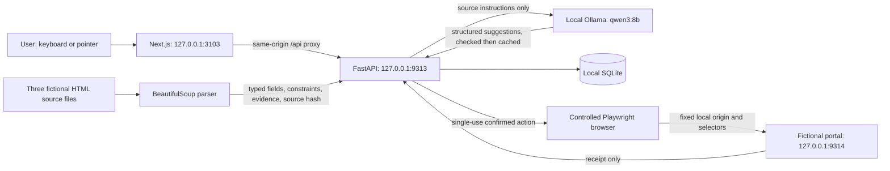
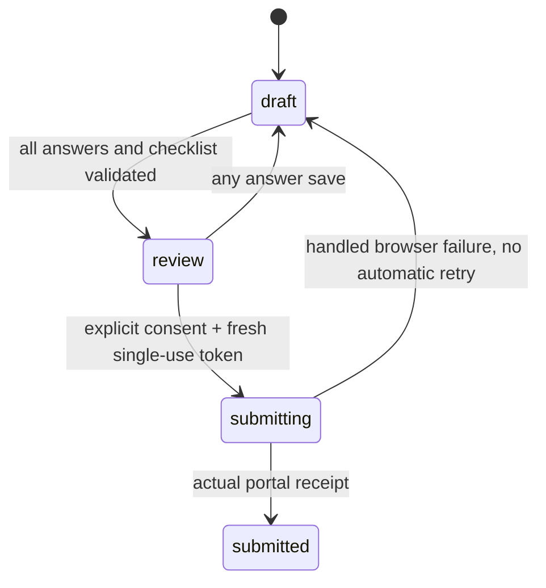

# Architecture

`backend/forms/*.html` is the source of truth and is served unchanged by the separate portal app. `parser.py` reads labels, `aria-describedby` instructions, required flags, selectable options, HTML constraints, fieldset sections, conditional-required attributes, checklist evidence, and ambiguity notices. The same parsed schema validates saved answers before submission and validates the fictional portal's POST.

Pydantic defines `Form`, `FormField`, `FieldEvidence`, `Requirement`, `UserAnswer`, `ProposedAction`, and `AuditEvent`. The frontend displays one active field per question, grouped by the parsed fieldset name. A conditional field becomes active when its source-defined controlling answer matches. Inactive values are removed on save. Wizard order follows DOM order; no model invents field order or requirements.

Qwen receives field metadata only. An explicit system instruction treats HTML text as untrusted data; structured output permits only field explanations. Output IDs must cover exactly the actual fields, without duplicates. Numbers must appear in that field's source prose, options, or HTML constraints. A limited claim filter rejects selected eligibility, upload/payment, URL, and date/deadline claims and required wording for optional fields. These checks do not prove complete semantic fidelity. The UI always preserves original source evidence and labels model text as suggestions.

One asyncio lock serializes inference per API process. HTTP timeouts and typed output validation produce visible failures; the original source remains usable. Cache keys include model name, digest, source hash, and guard version. There is no fake response path. The shared Ollama service is neither restarted nor reconfigured; other projects can still contend for compute, so latency varies.

SQLite stores answer JSON, checklist IDs, step, source hash, revision, state, receipt, and timestamps under `data/`. The browser stores only the high-entropy draft capability and reading preferences. SQL values are parameterized. `PRAGMA secure_delete=ON` overwrites deleted SQLite content, without claiming forensic removal of backups or generated demo files. API and portal access logs are disabled by the start script; Next development incoming-request and browser-forwarded logs are disabled.

Submission uses this state machine:

Preparing review creates a random token; only its SHA-256 digest is stored. It expires after ten minutes. Saving invalidates it. Submission atomically consumes it under `BEGIN IMMEDIATE`, rechecks source hash and validation, and commits `submitting` before launching automation. Duplicate/replayed requests cannot launch another submission from that token. Audit metadata contains fixed event descriptions and form identifiers, not answer values.

Playwright uses a fresh context without storage state or account cookies and allows network traffic only to the configured loopback portal origin. It fills fixed evidence selectors using reviewed answers, then clicks the portal's submit button and reads the actual receipt. The model has no browser or database tools. Arbitrary URLs, real websites, authentication, and CAPTCHA handling are outside the implementation.

Mutating API requests reject a present Origin other than the configured frontend origin. No CORS wildcard exists. Services bind only to loopback. This is a local capability-based prototype, not an authenticated multi-user service. JSON/document size limits are basic, and there is no production rate limiter or encrypted database. A process crash while `submitting` needs manual reconciliation; automatic retries are intentionally absent.

The frontend uses semantic landmarks, native controls, explicit labels, a focusable heading on each view/question, announced errors/status, a skip link, accessible checklist controls, font scaling, high contrast, and system reduced-motion preferences. shadcn-style Button composition uses Radix Slot; complex custom ARIA widgets were avoided because native controls already provide the necessary keyboard behavior.
